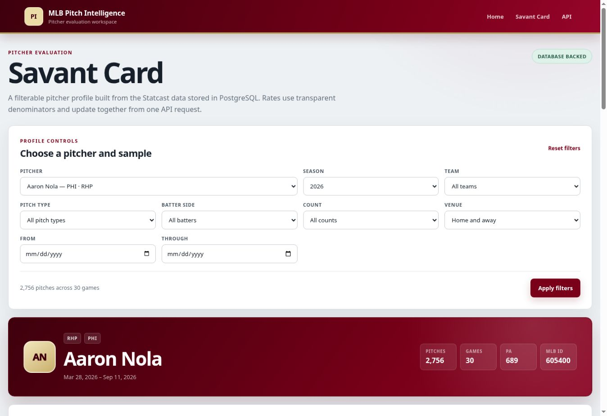
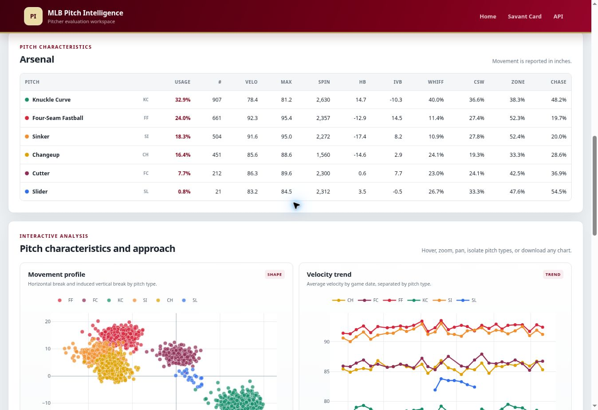

# MLB Pitcher Dashboard

[](https://github.com/bdrisc/mlb-pitcher-dashboard-flask/actions/workflows/ci.yml)

**Stack:** Python · Flask · PostgreSQL · SQLAlchemy · Alembic · Plotly · Docker · Render

**[Open the live Pitcher Report](https://mlb-pitch-intelligence.onrender.com/savant-card)** ·
**[Browse the pitcher API](https://mlb-pitch-intelligence.onrender.com/api/v1/pitchers)**

MLB Pitcher Dashboard is a production Flask and PostgreSQL statistical evaluation platform for
comparing pitcher outcomes, plate discipline, contact quality, arsenals, shape, command, and
trends from MLB Statcast data. It combines
a reproducible data-ingestion pipeline, versioned JSON APIs, shared filter validation, a
responsive Savant-style interface, and five interactive Plotly visualizations.

**Portfolio role:** this project demonstrates statistics-first product design, relational data
modeling, SQL aggregation, automated data refresh, and production Flask architecture. Its
companion Video Scouting Workspace focuses on film review, clip organization, and scouting notes
rather than repeating this application's full statistical report.



## Portfolio highlights

- **Production Flask architecture:** application factory, browser and API blueprints, Jinja
  templates, service modules, environment-backed configuration, and structured error handling.
- **PostgreSQL data layer:** SQLAlchemy models, Alembic migrations, SQL-level aggregations,
  transactional upserts, stable pitch identifiers, and auditable ingestion runs.
- **Statcast pipeline:** resumable season acquisition, cached five-day downloads, bounded-memory
  CSV streaming, schema validation, deterministic production sampling, and idempotent reloads.
- **Interactive pitcher evaluation:** filters for pitcher, season, team, pitch type, batter side,
  count, venue, and date range; arsenal tables; platoon splits; and denominator-aware metrics.
- **Software delivery:** 58 automated tests, Ruff checks, GitHub Actions CI, Docker Compose,
  Gunicorn, a non-root production image, and public deployment on Render.



## Data scope

The public application contains **133,933 pitches from the 50 busiest MLB pitchers** through
September 14, 2026. Every pitch thrown by each selected pitcher is retained, so arsenal usage,
game trends, platoon splits, and rate denominators remain internally valid.

The local acquisition pipeline supports the full-league dataset. The current local build contains
**663,035 MLB pitches** through September 14, 2026; that larger cache remains outside Git while the
reproducible acquisition command and compressed portfolio sample are included in the repository.

> The public app runs on Render's free infrastructure and may need a short cold start before the
> first request completes.

## Project structure

```text
mlb-pitch-intelligence-flask/
├── app/
│   ├── blueprints/
│   │   ├── api.py
│   │   └── main.py
│   ├── commands/statcast.py
│   ├── services/
│   │   ├── database_queries.py
│   │   ├── filters.py
│   │   ├── pitch_data.py
│   │   ├── pitcher_charts.py
│   │   ├── pitcher_profiles.py
│   │   ├── plots.py
│   │   ├── statcast_acquisition.py
│   │   └── statcast_ingestion.py
│   ├── static/
│   │   ├── savant-card-charts.js
│   │   ├── savant-card.js
│   │   └── styles.css
│   ├── templates/
│   │   ├── base.html
│   │   ├── index.html
│   │   └── savant_card.html
│   ├── __init__.py
│   ├── config.py
│   ├── extensions.py
│   └── models.py
├── data/
│   ├── sample_statcast.csv
│   └── production_statcast_2026.csv.gz
├── .github/workflows/ci.yml
├── migrations/
├── scripts/docker-entrypoint.sh
├── tests/
├── .dockerignore
├── .env.example
├── Dockerfile
├── docker-compose.yml
├── gunicorn.conf.py
├── render.yaml
├── requirements.txt
├── requirements-data.txt
├── requirements-dev.txt
└── wsgi.py
```

## Windows setup

From PowerShell in the project folder:

```powershell
py -3.10 -m venv .venv
Set-ExecutionPolicy -Scope Process -ExecutionPolicy RemoteSigned
.\.venv\Scripts\Activate.ps1
python -m pip install --upgrade pip
python -m pip install -r requirements-dev.txt
Copy-Item .env.example .env
```

Create a PostgreSQL database named `mlb_pitch_intelligence`. You can use pgAdmin or:

```powershell
createdb -U postgres mlb_pitch_intelligence
```

Open `.env` and replace `replace-with-your-password` in `DATABASE_URL` with your PostgreSQL
password. Then build the four database tables from the included migration:

```powershell
flask --app wsgi db upgrade
```

Start the browser application:

```powershell
flask --app wsgi run --debug --port 8080
```

Open `http://127.0.0.1:8080`. After ingesting data, the Savant Card is available at
`http://127.0.0.1:8080/savant-card`.

The included CSV is an explicitly fictional Statcast-shaped sample that makes the project
runnable before a real MLB export is added. Set `PITCH_DATA_PATH` in `.env` to use another CSV.

## Ingest an MLB Statcast export

Place an authorized Baseball Savant CSV in `data/raw/`. That directory is excluded from Git.
From the repository root, run:

```powershell
flask --app wsgi statcast ingest data\raw\statcast.csv
```

The command:

- validates the required Statcast columns and numeric fields;
- generates `game_pk_at_bat_number_pitch_number` as the stable pitch ID;
- standardizes pitch names;
- derives strike, swing, contact, whiff, CSW, zone, chase, and hard-hit flags;
- converts Statcast movement from feet to inches;
- upserts players, games, and pitches without duplicating existing pitch IDs;
- rolls back every baseball-data write if any part of the load fails; and
- writes a succeeded or failed record to `ingestion_runs` with the source hash and row counts.

Rerunning a corrected or expanded export is safe. Existing pitches are updated and new pitches
are inserted.

The bundled fictional sample now uses the complete ingestion schema. It can safely populate a
new development database before you obtain a real Baseball Savant export:

```powershell
flask --app wsgi statcast ingest data\sample_statcast.csv
```

The sample creates fictional pitcher MLB ID `999001` for local API testing.

## Download the complete 2026 season locally

The local Flask app uses the PostgreSQL connection in your local `.env`; it does not use the
Render database. Install the optional data-acquisition dependency in the activated virtual
environment:

```powershell
python -m pip install -r requirements-data.txt
```

Download every completed 2026 regular-season date through September 14 and ingest each cached
chunk into local PostgreSQL:

```powershell
flask --app wsgi statcast fetch-season 2026 --through 2026-09-14
```

The command requests five calendar days at a time, excludes spring-training and incomplete
records, caches usable rows under `data/cache/statcast/2026/`, and commits each chunk through the
existing idempotent ingestion service. The cache directory is excluded from Git. If a request
fails, rerun the same command: completed chunks are reused and the database upserts prevent
duplicates.

After the real-season load completes successfully, remove only the bundled fictional records:

```powershell
flask --app wsgi statcast remove-fictional-sample
```

This command targets the sample's reserved game and player IDs. It does not delete real MLB
pitches or clear the ingestion audit history.

To extend the local database after additional games are played, use a later completed date or
omit `--through` to use yesterday:

```powershell
flask --app wsgi statcast fetch-season 2026
```

To update only the deployed pitcher cohort, redownload a small overlapping window and upsert it:

```powershell
flask --app wsgi statcast sync-recent --lookback-days 4
```

The overlap captures delayed Statcast corrections without creating duplicates. If the database is
more than four days behind, the command starts from its latest stored game date and catches up in
seven-day chunks. It keeps the public cohort stable by discarding pitches from pitchers who are
not already represented in PostgreSQL.

Useful alternatives:

```powershell
# Download and cache without changing PostgreSQL
flask --app wsgi statcast fetch-season 2026 --download-only

# Replace existing cache files with fresh Baseball Savant responses
flask --app wsgi statcast fetch-season 2026 --force-download
```

## Build the public top-50-pitcher dataset

After the local season acquisition finishes, create a compressed production export containing
the 50 pitchers with the most pitches and every cached pitch thrown by those pitchers:

```powershell
flask --app wsgi statcast build-production-sample 2026 --pitchers 50
```

This produces:

- `data/production_statcast_2026.csv.gz`, the deployable ingestion source; and
- `data/production_statcast_2026.manifest.json`, the selection rule, row count, MLB IDs, names,
  and pitch totals needed to document the public sample.

The production export is intentionally selected by complete pitcher history rather than random
pitch rows. That keeps arsenal usage, trends, splits, and rate denominators internally valid.
The checked-in production file contains 133,933 pitches from the 50 busiest pitchers through
September 14, 2026. The full league cache remains local and is never committed.

## Expected run value (xRV)

The pitcher report shows **xRV/100** directly beside the existing,
unchanged Savant-aligned **RV/100**, in the same featured card and the arsenal
Results table. The separate run-value comparison section, sample-coverage
banner, and additional RV-minus-xRV columns are hidden from the interface.

xRV is a custom contact-adjusted metric calculated from observed per-pitch
RV plus the difference between observed and Statcast expected contact
wOBA, converted to runs using the corresponding seasonal FanGraphs scale.
The API still includes paired RV, actual-minus-expected values, contact
coverage, and sample-quality warnings for deeper analysis. The displayed
RV/100 uses all qualifying physical pitches, while xRV/100 uses only
pitches that can be scored; their denominators may differ slightly.

A real 2026 public-cohort audit covered 50 pitchers and 24,200 tracked
contact plays. Contact wOBA was well calibrated in aggregate, but the
July 1 chronological split-half test **did not show a statistically reliable
predictive advantage** over observed RV/100. This remains a **descriptive,
contact-adjusted metric**, not an official Baseball Savant xRV or
FanGraphs PitchingBot xRV. See [methodology, exclusions, live-data
validation and rerun instructions](docs/expected_run_value.md).

To repeat the audit on any populated local database:

```bash
python -m scripts.audit_xrv --season 2026
```

## Public versus local metric parity

**Both dashboards share the same Python/SQL calculation code, but not a live
database connection.** The public instance stores complete pitch histories
for the selected 50 pitchers in Neon; the local database can contain the
entire MLB season. The public pitcher dropdown is a *selection*, not a
statistical sample of each selected pitcher's games. Both installations use
the same versioned 2025 full-MLB VAAAdj/HAAAA models and 2026 full-MLB
movement reference. Published FIP/xFIP/SIERA/xERA and Stuff+/Location+/
Pitching+ are independently refreshed official sources.

To check **every field in a pitcher profile**, rather than just the visible
rounded RV/xRV cards, activate the local Python environment in the
repository directory and run:

```powershell
python -m scripts.check_dashboard_parity --pitcher 605400 --season 2026
```

To locate a mismatched game date, run the optional (slower) per-game audit:

```powershell
python -m scripts.check_dashboard_parity --pitcher 605400 --season 2026 --by-game
```

To compare the full public cohort against your local database:

```powershell
python -m scripts.check_dashboard_parity --all --season 2026 --output data/dashboard_parity_2026.json
```

The audit makes **read-only** calls to your local database and the public
profile API; it never sends local records or credentials to Render. Matching
pitch counts alone do not prove that values match: pitch-level RV revisions,
Statcast xwOBA corrections, or incomplete local backfills can change a
rounded metric by 0.1 or more. If Aaron Nola's local *RV* does not match
Savant after comparing, you can refresh just his local context-neutral RV:

```powershell
python -m flask --app wsgi statcast refresh-run-values --pitcher 605400 --season 2026
```

Run the comparison again afterward to see whether any other metrics differ.
Do not overwrite the local database to force numerical agreement.

**Data-source limitation:** The public app cannot query the user's
Windows-local PostgreSQL server. Making the local dataset authoritative on
the public site requires an explicit, safely exported and imported canonical
50-pitcher source snapshot. Git pulls synchronize *code*, not pitch rows;
this repository does not silently upload the local database.

On Render, startup maintenance now runs its final Savant RV verification
**after** recent Statcast sync. Previously the sync could overwrite verified
RV with a different CSV vintage. Failed source verifications still preserve
old RV values and are reported rather than silently accepted.

### Reconciling missing public xSLG from your local full-season data

The public pool may lack official expected SLG on some contact events even
when the local database has more complete Statcast coverage. For example,
Aaron Nola had 30 unscored public 2026 xSLG contact events concentrated in
September 17 and September 23. These are not filled by the normal public
seed file, so public xSLG can differ from local despite matching pitch counts.

Export existing xSLG observations **without modifying the local database**:

```powershell
python -m scripts.export_local_xslg --all --season 2026
```

This writes `outputs/local_xslg_public_pool_2026.csv.gz` for the public
pitcher IDs only. Its columns are pitch identity, pitcher ID, game date,
event, and the locally stored expected SLG; no connection strings or secrets
are included. The `outputs/` folder is Git-ignored.

**Important:** Export alone does NOT change the public site. Upload the file
for a verified, source-identity-matched import of **missing values only**;
do not overwrite non-null public estimates or unverified run values. Compare
the two dashboards again after import.

### Diagnosing residual local/public metric differences

Run the full public-cohort parity audit after the local Savant RV refresh.
When some pitchers still differ, export their **actual local source inputs**
so individual pitch identities and classifications can be checked against
Neon rather than inferring causes from rounded profile aggregates:

```powershell
python -m scripts.export_parity_inputs --audit outputs/dashboard_parity_after_rv_refresh_2026.json
```

This **read-only** command selects only pitchers marked as mismatched in
the audit, verifies that local pitch counts match the audit for each,
and writes two Git-ignored compressed CSVs:

- `outputs/parity_source_pitches_2026.csv.gz`: each selected pitch ID,
  game date, pitch classification, and pitch-level metric input
- `outputs/parity_source_fangraphs_2026.csv.gz`: the corresponding stored
  published FanGraphs pitch-grade inputs and refresh timestamps

The exporter does not read credentials or modify either database. It will
reject partial or changed pitch inventories. Use these files to diagnose
the differences before any database update: public records may contain
newer classifications, fresher published grades, or more complete arm
angles than the local records. Never overwrite those fields blindly merely
to make dashboard values match. A corrected canonical public import must
be identity-validated and keep the source-of-truth rules explicit.

### Aligning meaningful pitch-classification differences with Baseball Savant

When public and local totals agree but pitch-type usage or pitch-pair
metrics differ, source classifications may have changed over time. Prefer
current Baseball Savant pitch identities and types instead of copying an
older local type to the public DB. Small 0.01/0.1 display differences can
be left alone without changing formulas or underlying measurements.

To inspect the 2026 mismatched public pitchers on your local database:

```powershell
python -m flask --app wsgi statcast refresh-pitch-types --season 2026 --audit outputs/dashboard_parity_refined_2026.json
```

The command defaults to a **dry run**. To apply verified official pitch-type
corrections to local records only:

```powershell
python -m flask --app wsgi statcast refresh-pitch-types --season 2026 --audit outputs/dashboard_parity_refined_2026.json --apply
```

Each pitcher-season is checked against Savant's current CSV. Every
locally stored pitch ID must appear in the official source. A small number
of additional *source-only* Savant rows (at most 2% of local pitches) may
be ignored: they are **never inserted or updated**. Missing local IDs,
too many source-only IDs, or >10% of pitches being arbitrarily reclassified
fail verification and preserve the saved types. A narrowly defined exception
allows a verified historical `CU` (curveball) to `KC` (knuckle curve) relabel:
at least 98% of the changed codes must be `CU->KC`, at most two other
classifications may change, at least 100 curve labels must be affected, and
no more than 30% of all stored pitches can change. Every stored pitch ID
must still match Savant and the source-only ID limit remains in force.
The command reports the curve relabel count and how many source-only
IDs were ignored. Successful updates change **only**
`pitch_type` and `pitch_name`: velocity, trajectory, RV, xRV inputs,
arm angle, xSLG, and all other measurements remain as stored.

On the public Render deployment, enabling `SYNC_PITCH_TYPES_ON_STARTUP=1`
runs the same verification for the **stored public pitcher pool only** during
startup maintenance. The default is disabled. The public dashboard never
needs a full-league pitch database simply to display the smaller pool,
although its league reference models must remain sourced from the full MLB
baseline.

Gavin Williams' 2026 data triggered the default cap because the locally
stored 665 ordinary curveballs are largely designated as knuckle curves
by current Savant. You can preview and then apply his official changes alone:

```powershell
python -m flask --app wsgi statcast refresh-pitch-types --pitcher 668909 --season 2026
python -m flask --app wsgi statcast refresh-pitch-types --pitcher 668909 --season 2026 --apply
```

After both environments have used the same official source, rerun
`python -m scripts.check_dashboard_parity --all --season 2026` to
review remaining material differences. This refresh does not overwrite
FanGraphs published grade snapshots, fix missing local arm angles, or resolve
pitcher-seasons that fail separate RV source verification.

### Fixing a revised official plate-appearance outcome

The normal wOBA backfill deliberately preserves stored outcomes whose event
labels differ from Savant. When a scoring revision occurs later, this can
leave local season wOBA blank even though the public DB has the newer label.
For example, Joey Cantillo's September 24, 2026 pitch `824707_34_5` was
originally stored as `field_error` locally but later recorded as `single`
by the public database and MLB Gameday.

Preview official scoring revisions with no database writes:

```powershell
python -m flask --app wsgi statcast reconcile-woba-outcomes --pitcher-id 676282 --season 2026
```

Apply **only** source-verified revised events and their exact Savant wOBA
components after reviewing the preview:

```powershell
python -m flask --app wsgi statcast reconcile-woba-outcomes --pitcher-id 676282 --season 2026 --apply
```

This independently verifies all pitcher-season plate appearances against
Savant's published total, requires every locally stored completed PA to
occur in the official source, and ignores at most a few additional
source-only PA identities (never inventing missing local pitches).
It rejects unexplained local PAs, large source discrepancies, or unexpectedly
large revisions, and touches only revised `events` and their published
`savant_woba_*` weights. Original movement, release/trajectory, xSLG,
pitch type, RV and other observations remain unchanged. It does not run
automatically at deployment.

### Pitch sequencing transition matrix

Both the local PostgreSQL dashboard and public Render/Neon dashboard display
a **Pitch Sequencing Transition Matrix** immediately after Pitch Separation.
Rows are the prior pitch type; columns are the next pitch type thrown to the
same hitter in the **same game and plate appearance**. Each heatmap cell
shows the conditional row share plus the observed transition count:

```text
P(next = SL | previous = FF, active next-pitch filters)
  = observed FF -> SL pairs / all observed pairs from FF with a matching next pitch
```

- Only pitches with adjacent `pitch_number` values count. A missing record
  cannot cause two nonadjacent pitches to be paired; a new PA never connects
  to the old one. Consecutive repeats such as FF→FF are included.
- Automatic balls/strikes and missing or unknown pitch types are excluded.
  Trajectory, RV and movement data are **not** required for a valid observed
  pitch-type transition.
- Existing season, date, handedness, team, venue, count and pitch-type filters
  apply to the **second** pitch only. The previous pitch is the real unfiltered
  predecessor. Selecting just one next pitch type conditions the denominator
  on that selected type; it does **not** estimate an unrestricted pitch-choice
  probability. Empty or small samples are displayed honestly with counts.
- The matrix reuses the source-verified consecutive pairs already aggregated
  for Pitch Tunneling, without a second SQL query or new database table.
  It is returned in `/api/v1/pitchers/<pitcher_id>/profile` as
  `pitch_transition_matrix`, works for every pitcher available in that
  environment, and updates when profile filters change.

## API routes

```text
GET /api/v1/ready
GET /api/v1/pitchers
GET /api/v1/pitchers/<pitcher_id>/profile
GET /api/v1/pitchers/<pitcher_id>/charts
GET /api/v1/pitches
GET /api/v1/plots/movement?pitcher=Sample%20Pitcher
```

## Savant Card

`GET /savant-card` serves a reusable Jinja page layout, while a separate JavaScript module
loads pitcher data from the versioned JSON API. The page includes:

- a database-backed pitcher selector;
- season, team, pitch type, batter side, count, venue, and date-range filters;
- URL-synchronized filter state for reproducible profiles;
- loading, empty-database, empty-sample, and structured API-error states;
- 10 headline metrics with denominator-aware formatting;
- a pitch-level arsenal table and right/left platoon cards;
- five interactive Plotly charts with hover details, legend isolation, zoom, pan, and PNG export;
- responsive layouts for desktop, tablet, and mobile screens.

The page does not calculate baseball metrics in the browser. It sends the active filter set to
the pitcher profile API and renders the returned SQL aggregates, keeping the API as the single
source of truth. It sends the same normalized filters to the chart-data API, so every metric,
table, and chart represents the same sample.

The five visualizations are:

1. movement profile by pitch type;
2. average velocity by game date;
3. release-point consistency;
4. pitch location with the sample's average strike zone;
5. pitch usage within each count.

Dense scatter plots are sampled deterministically at 6,000 points for browser performance, while
the velocity and count-usage calculations continue to use the complete filtered sample. Plotly.js
is loaded from its official CDN with an explicit version rather than the frozen
legacy `plotly-latest` bundle.

`GET /api/v1/pitchers` is a database-backed directory that returns stable MLB IDs, names,
throwing hands, teams, pitch counts, game counts, and date coverage. It accepts the shared
filters, including a partial `pitcher` name search.

`GET /api/v1/pitchers/<pitcher_id>/profile` returns:

- pitcher identity and teams represented in the filtered sample;
- sample sizes and first/last game dates;
- overall velocity, shape, plate-discipline, contact-quality, strikeout, and walk metrics;
- pitch-level arsenal usage and performance metrics; and
- right- and left-handed batter splits.

`GET /api/v1/pitchers/<pitcher_id>/charts` returns five chart-ready datasets. It selects only the
database columns needed for the visualizations, applies the shared filter contract before data
leaves PostgreSQL, and retains `null` rates when a pitch type has no valid opportunity denominator.

All aggregations execute in SQL. The API reports rates as percentages, returns `null` when a
rate has no valid denominator. Avg Exit Velocity, Hard-Hit%, and `xwoba_on_contact` use only
tracked balls in play; foul-ball exit readings and pitch-level plate-appearance estimates are
excluded.

After ingesting the fictional sample, open:

```text
http://127.0.0.1:8080/api/v1/pitchers/999001/profile?season=2026
http://127.0.0.1:8080/api/v1/pitchers/999001/charts?season=2026
```

The pitch summary and movement chart use the same validated filters:

| Query parameter | Accepted values |
| --- | --- |
| `pitcher` | Case-insensitive partial name; required for the movement chart |
| `team` | Two- or three-letter MLB team code |
| `pitch_type` | Statcast code or full name; repeat it or use commas for multiple types |
| `batter_side` | `R`, `L`, `right`, or `left`; supports multiple values |
| `season` | Integer from 2008 through the current year |
| `date_from`, `date_to` | Inclusive ISO dates in `YYYY-MM-DD` format |
| `balls` | Integer from 0 through 3 |
| `strikes` | Integer from 0 through 2 |
| `home_away` | `home`, `away`, `H`, or `A` |

Example:

```text
/api/v1/pitches?pitcher=Sample%20Pitcher&pitch_type=FF,SL&batter_side=R&season=2026
```

Scalar filters may appear only once. Unknown parameters, unsupported categorical values,
out-of-range counts, malformed dates, and reversed date ranges return HTTP `400` with details
for every invalid field:

```json
{
  "error": "validation_error",
  "message": "Invalid query parameters.",
  "details": {
    "balls": ["must be between 0 and 3"]
  }
}
```

## Tests and code quality

```powershell
python -m pytest
python -m ruff check .
python -m ruff format --check .
```

The suite covers route behavior, filter validation, Statcast ingestion, pitcher-profile and
chart aggregations, production configuration, security headers, and the deployment manifests.
The GitHub Actions workflow runs these checks against PostgreSQL 17 on Python 3.10 and 3.12,
smoke-tests the migrated API, and builds the Docker image before a pull request can be merged.

## Run the complete stack with Docker

Install and start Docker Desktop, then run this from the repository root:

```powershell
docker compose up --build
```

Compose starts PostgreSQL 17, waits for it to become healthy, applies the database migrations,
loads the fictional sample data idempotently, and serves the Flask app through Gunicorn at
`http://127.0.0.1:8080`. The API health check is available at
`http://127.0.0.1:8080/api/v1/ready`.

Press `Ctrl+C` to stop the foreground process, then remove the stopped containers:

```powershell
docker compose down
```

The named PostgreSQL volume preserves the database between runs. Only use
`docker compose down -v` when you intentionally want to erase that local Docker database.

## Deploy on Render

`render.yaml` defines a free Docker web service with an externally supplied PostgreSQL
connection. The public deployment uses Neon PostgreSQL; local Docker Compose still runs its own
PostgreSQL 17 database.

The current public deployment uses the existing Neon **Launch** organization, with a 0.25–0.5 CU
compute and a five-minute idle timeout. Render web hosting remains on its Free plan.

1. Create a Neon project near the existing Render service's region (Oregon for this deployment).
   For a new account, the Free plan is an alternative if its quotas fit your dataset.
   Select PostgreSQL 17 to match the local and CI environments.
2. Copy the **direct** PostgreSQL connection URL from Neon's Connect dialog. Keep the supplied
   SSL parameters. This one-worker app can use a direct connection for both migrations and queries.
3. In the existing Render web service's **Environment** settings, replace `DATABASE_URL` with
   that URL. Store it only as a secret environment variable, never in GitHub source code.
   `sync: false` in the Blueprint leaves the secret under dashboard control. For an existing
   Blueprint, set this value manually; syncing the YAML alone will not replace the old URL.
4. Deploy the updated code to the existing Render web service to keep its public URL. Set its
   **Health Check Path** to `/api/v1/live` if the service is not managed by a Blueprint.
5. Keep `RUN_MIGRATIONS=1`, `SEED_DATABASE=1`,
   `STATCAST_SEED_PATH=data/production_statcast_2026.csv.gz`, and `SYNC_RECENT_ON_STARTUP=1`.
   Startup maintenance applies migrations, imports the bundled production dataset into an empty
   database, then refreshes the existing pitcher cohort. It runs in the background, so the page
   can open before the data is ready. Wait for the successful maintenance messages in deploy logs.
6. Check `/api/v1/ready` manually for database readiness, then open `/api/v1/pitchers` and a
   Savant Card to verify the data and charts. The `/api/v1/live` hosting probe and legacy `/api/v1/health` alias check only the
   web process so routine health checks do not keep Neon's database awake.
7. In Neon's SQL Editor, check storage after the initial load and periodically as data grows:

   ```sql
   SELECT pg_size_pretty(pg_database_size(current_database())) AS database_size;
   ```

Neon's current Free plan includes 1 GB of database storage and 100 CU-hours per project per
month. Check the console's usage meters and [current pricing](https://neon.com/pricing) before
expanding the public dataset. The database scales to zero when idle; the first query may take
longer. Avoid uptime monitors that repeatedly call database-backed routes. Render's free web
service also sleeps when idle and retains its existing monthly usage limits.

The old Render database is no longer declared in this Blueprint. Do not delete it until the new
database has been verified and any data absent from the bundled seed has been recovered or
redownloaded. An expired Render database requires an upgrade to regain access; rebuilding from
the checked-in seed and public Statcast source avoids depending on that export. Ingestion audit
history from the old database is not recreated. The existing daily Render deploy-hook workflow
continues to refresh the Neon-backed deployment without a new GitHub secret.

Render generates the production secret. `PITCH_DATA_PATH` keeps the small fallback source used
by legacy in-memory routes separate from `STATCAST_SEED_PATH`, the database-ingestion source.
Later restarts detect existing MLB data and skip the seed import.

Deployments created before `STATCAST_SEED_PATH` was introduced remain compatible: when the
production `PITCH_DATA_PATH` still points to the compressed seed file, Flask automatically uses
the bundled six-row CSV only for the lightweight in-memory fallback while the full compressed
file is streamed into PostgreSQL.

For other Linux container platforms, the production process is:

```text
gunicorn --config gunicorn.conf.py wsgi:app
```

Set `APP_ENV=production`, a strong `SECRET_KEY`, `DATABASE_URL`, and `BEHIND_PROXY=1`. The app
refuses to start in production when the development-only secret is still configured.

### Free daily data refresh

The checked-in `Daily Statcast Sync` GitHub Actions workflow triggers a normal Render deployment
at 15:00 UTC during the regular-season window (March 15 through October). During startup, the web
service downloads the previous four days through yesterday, retains only the deployed pitcher
cohort, and transactionally upserts those pitches. The old deployment remains available if a
refresh fails, and offseason deployments do not consume the free build allowance.

Complete these one-time setup steps after deploying the branch:

1. Open the Render web service's **Settings** page and create or copy its deploy hook URL.
2. In GitHub, open **Settings → Secrets and variables → Actions**, create a repository secret
   named `RENDER_DEPLOY_HOOK_URL`, and paste the deploy hook URL as its value.
3. Open **Actions → Daily Statcast Sync** and run the workflow manually once.
4. Confirm the Render deploy logs contain `Recent Statcast sync completed` and the Savant Card's
   database coverage date advances.

The deploy hook is a credential and must never be committed. GitHub can disable scheduled
workflows on inactive public repositories after an extended period, so confirm the workflow is
enabled before each new season.

## Architectural decisions

- `create_app()` prevents configuration and data state from being locked to one module import.
- Blueprints separate server-rendered pages from the versioned JSON API.
- `PitchDataStore` owns source detection, normalization, filtering, and summaries.
- Flask-SQLAlchemy owns the relational model layer and Flask-Migrate owns schema revisions.
- The `statcast` Flask CLI group keeps repeatable data work outside request handlers.
- `PitchFilters` gives browser, chart, and future database endpoints one canonical query contract.
- Filter responses expose normalized MLB codes so URLs are reproducible across clients.
- Pitcher profiles aggregate inside PostgreSQL instead of loading an entire season into Python.
- The pitcher directory exposes stable MLB IDs for the Savant Card player selector.
- Chart queries reuse the exact profile filters and select only visualization fields from the
  database.
- Plotly rendering lives in its own browser module instead of mixing chart code into Flask views.
- Rate denominators are explicit, and zero-opportunity rates serialize as `null` rather than zero.
- Plot generation is isolated from request handling and uses a non-interactive backend.
- Missing or invalid data produce readable `503` responses while the app remains diagnosable.
- The health endpoint verifies both the SQL connection and pitch-data source for orchestrator
  manual readiness checks; hosting probes use the database-free liveness endpoint.
- Gunicorn serves production traffic, while `ProxyFix` is enabled explicitly behind a trusted
  platform proxy.
- The container runs as an unprivileged user and starts only after optional migration and sample
  ingestion hooks finish successfully.
- CI proves migrations, ingestion, API responses, linting, formatting, and image construction on
  every proposed change.
- MLB Statcast movement is converted from feet to inches during normalization.
- The original TrackMan schema remains temporarily supported so the restructure does not discard
  the prototype's earlier functionality.

## FanGraphs pitch models

Pitcher reports include FanGraphs' published Stuff+, Location+ and Pitching+
as the final three main metrics and adjacent arsenal columns, in that order. These are **regular-season reference grades**, not calculations from the
filtered Statcast pitches. Select one season. Date, team, count and handedness
filters do not change the season reference. Missing grades display as a dash.
Source metadata and import time remain in the profile API.

FanGraphs fastball (`FA` / API `sp_s_FF`) maps to Statcast four-seam (`FF`).
Sinker, cutter, curveball, knuckle curve, changeup, splitter and forkball map by
category. Sweeper/slurve grades are not inferred from slider grades. When a
pitcher has a Statcast sweeper/slurve during the season and FanGraphs does not
provide separate sweeper grades, the slider row is also withheld, even when the
current filters hide those other pitches. Overall Stuff+ remains available.

The bundled `data/fangraphs_stuff_2026.csv` snapshot was retrieved from the
[FanGraphs leaderboard](https://www.fangraphs.com/leaders/major-league?stats=pit&qual=0&type=36&season=2026&season1=2026)
on October 17, 2026 UTC (October 16 Eastern): 868 pitchers, minimum innings zero.
It stores only IDs, season and published Stuff+, Location+ and Pitching+ grades. It is not a fitted model.
Source methodology: [FanGraphs primer](https://library.fangraphs.com/pitching/stuff-location-and-pitching-primer/).

### Local update

After pulling the repository, rebuild the local Docker app:

```bash
git pull origin main
docker compose up -d --build
```

Startup applies migrations, seeds the snapshot if a season lacks the complete model metrics,
and attempts a live refresh. The same startup steps run on Render. The existing
daily deploy workflow therefore refreshes both Statcast and FanGraphs. Refresh
failure leaves the previous snapshot intact and never prevents the web server
from starting. Set `SYNC_FANGRAPHS_ON_STARTUP=0` to disable seed/refresh maintenance.
No new paid service or credentials are required for this acquisition route.

For a Python environment:

```bash
flask --app wsgi db upgrade
flask --app wsgi fangraphs seed-if-needed
flask --app wsgi fangraphs sync --season 2026
```

Manual refresh in Docker:

```bash
docker compose exec web flask --app wsgi fangraphs sync --season 2026
```

Acquisition uses a single server-side FanGraphs leaderboard request, with a
30-second network timeout and a 120-second subprocess limit. It verifies the
response season, schema and complete row count before importing. This is an
undocumented upstream endpoint and may change; the saved snapshot remains usable.

### CSV fallback

Export a single-season FanGraphs pitching leaderboard with minimum innings zero,
overall Stuff+, Location+, Pitching+ and the `Stf+`, `Loc+`, `Pit+` pitch columns. Use combined pitcher totals rather
than separate team rows. Supply `mlb_id`/`MLBAMID`, or a CSV crosswalk containing
`key_fangraphs` and `key_mlbam`. Names are never used for matching.

```bash
flask --app wsgi fangraphs import-csv fangraphs.csv --season 2026 --crosswalk register.csv
```

Imports validate before changing saved grades, replace each matched pitcher's
season snapshot transactionally, and report unmapped pitchers. Missing pitch
grades in a successful replacement are cleared instead of retaining stale values.

## Run Value per 100 Pitches

RV/100 appears immediately before Stuff+ in the main metrics and arsenal table.
It uses Baseball Savant's context-neutral CSV run value, reverses the batter-facing
sign to pitcher value, and divides by all physical pitches, including pitches with missing run values. Positive
values mean runs prevented. Zero is valid; entirely missing data display a dash.
Overall RV/100 is weighted by physical pitch counts. Dates, handedness, count,
team, home/away and pitch filters apply to the calculation. Hover shows coverage.

The calculation was validated against Savant's neutral aggregate and all six
pitch types for Aaron Nola; see [validation](docs/rv100-validation.md).
Source pitch classifications are retained. A historical database snapshot may
differ from a subsequently revised Savant export or a full-season leaderboard.

For the full local PostgreSQL app, stop Flask with Ctrl+C, then run:

```powershell
git pull origin main
.\.venv\Scripts\Activate.ps1
python -m flask --app wsgi statcast refresh-run-values --season 2026
python -m flask --app wsgi run --debug --port 8080
```

The refresh updates only run values on pitches already in the local database.
It verifies each pitcher-season CSV against Savant's explicit context-neutral
aggregate before writing, and preserves the previous values on failure. It does
not import the public cohort or add or remove any pitches. The first full local
refresh downloads data for each existing pitcher and can take several minutes.
Use `--pitcher MLB_ID` to refresh one pitcher, or omit `--season` to refresh all
stored seasons. The public Docker app performs this refresh in background
maintenance on startup; `SYNC_RUN_VALUE_ON_STARTUP=0` disables it.

Open `http://127.0.0.1:8080/savant-card`. No new migration is needed. The local
commands use the existing `.env` connection to the full PostgreSQL database.


### Overall wOBA

The Overall Results card shows actual **wOBA** allowed beside **xwOBA**.
Actual wOBA divides the sum of Baseball Savant's exact actual outcome weights
by its eligible plate appearances on the selected terminal pitches. The
backfill verifies Savant's numerator and rate against Statcast Search before
matching the records to the stored pitches. Intentional walks and sacrifice
bunts contribute neither weight nor an eligible appearance. Filters restrict
the calculation to the tracked pitch sample; it can differ from a Savant
leaderboard using a different sample. A dash means no eligible appearances or
some selected outcomes still need verification.

For a native local installation, stop Flask and use the existing virtual
environment and database:

```powershell
git pull origin main
python -m flask --app wsgi db upgrade
python -m flask --app wsgi statcast backfill-woba --season 2026
python -m flask --app wsgi run --debug --port 8080
```

The backfill updates only the two actual wOBA fields on existing pitches and
can be resumed by repeating the command. Omit `--season` to process all stored
seasons. The public app runs the migration and backfills in the background.
`SYNC_WOBA_ON_STARTUP=0` disables automatic backfill.

### Overall xwOBA Against

The main pitcher card shows `xwOBA` to three decimals. It averages
Statcast's `estimated_woba_using_speedangle` on completed plate appearances,
including the supplied strikeout, unintentional-walk and hit-by-pitch weights.
Intentional walks, sacrifice bunts, catcher interference and truncated plate
appearances are excluded. Missing expected values stay missing; they are not
replaced with actual hit results or zero. This differs from xwOBAcon, which
measures contact only. All dashboard filters apply before aggregation.

This uses fields already stored in both databases. No migration, refresh or
re-import is required: pull `main` and restart the native Flask app locally.

### VAA and HAA by pitch type

The arsenal table includes raw VAA and HAA in degrees beside HB/IVB. They
average each tracked pitch's calculated angle at the front of home plate,
with all dashboard filters applied. VAA is negative for descending pitches;
positive HAA points toward the catcher's right. Hover a cell for tracking
coverage. Missing fits display as `—`. These are raw angles, without location
or handedness normalization. See [the calculation and validation](docs/approach-angle-validation.md).

For the existing native Windows app, stop Flask, activate your usual virtual
environment and run against your existing full PostgreSQL database:

```powershell
git pull origin main
.\.venv\Scripts\Activate.ps1
python -m flask --app wsgi db upgrade
python -m flask --app wsgi statcast backfill-approach-angles --season 2026
python -m flask --app wsgi run --debug --port 8080
```

Backfill fetches trajectory data for your stored pitchers and updates only
existing trajectory/angle fields. It preserves the full local pitcher cohort
and all other metrics. It can take several minutes for a full season; rerun
the same command after any download failure to resume unprocessed pitches.
Use `--pitcher MLB_ID` for one pitcher. Optional `--csv-path PATH_TO_STATCAST_CSV`
uses a previously downloaded complete Statcast CSV first, then fetches only
remaining unprocessed pitches. No re-import of the public sample is required.

On the public app, migrations run before the web process and the background
backfill fills the existing cohort automatically. Future ingestion calculates
these angles from `vx0`, `vy0`, `vz0`, `ax`, `ay`, and `az`.

### HAA Above Expected (HAAAA)

HAAAA appears directly beside HAA in each pitch-type row. It is signed
`observed HAA - expected HAA`, with expected HAA modeled by pitch type and
throwing hand from release side and front-plane horizontal location. The
frozen reference is trained on 2025 MLB data and evaluated on 2026. Both
installations use the same coefficients. See [method and validation](docs/haaaa.md).

In your usual activated virtual environment, stop the native Flask app and run:

```powershell
git pull origin main
python -m flask --app wsgi db upgrade
python -m flask --app wsgi statcast backfill-approach-angles --season 2026
python -m flask --app wsgi statcast backfill-haaaa --season 2026
python -m flask --app wsgi run --debug --port 8080
```

The raw-angle command skips already processed pitches. HAAAA scoring runs
locally from the stored trajectories and frozen reference, preserving your
full pitcher database. No league training download is required locally.
Missing data or unsupported pitch-type/hand groups display as `—`; hover for
coverage. Positive/negative HAAAA retains raw HAA's coordinate direction,
not a universal better/worse ranking. The public app backfills automatically.

### Pitch separation: velocity and movement

The Pitch separation table below Arsenal performance compares pitch-type
averages in the active sample. It shows the absolute velocity gap in mph,
signed ΔHB/ΔIVB in inches (B minus A), and the distance between the two mean
movement vectors. The reference selector starts with the most-used fastball;
choose another pitch or All pitch pairs. Hover cells for tracking coverage.

All global filters apply. Choose All pitch types to compare a full arsenal;
a one-type sample has no pair to compare. Larger gaps are descriptive, not a
universal quality grade. See [formulas, samples and repository context](docs/pitch-separation.md).

This update uses existing database fields and needs no new migration,
backfill or data download. In the activated native Flask environment, stop
the server, pull and restart:

```powershell
git pull origin main
python -m flask --app wsgi run --debug --port 8080
```


### Swinging-strike rate (SwStr%)

The main card and each arsenal row show SwStr% beside Whiff%. SwStr% is
100 × (`swinging_strike` + `swinging_strike_blocked`) / pitches thrown.
Foul tips and bunt attempts do not enter the numerator; their thrown pitches
remain in the denominator. Automatic balls and automatic strikes are excluded
from the denominator. Physical pitches with an unknown pitch type or missing
tracking measurements remain eligible. This is separate from the existing
Whiff% grouping and denominator (per swing).

The API exposes `swstr_pct`, `swinging_strike_count`, and `swstr_pitch_count`
overall, by pitch type, and in platoon split data. All active filters apply before
aggregation, and the overall rate uses pooled counts rather than an average of
pitch-type percentages. Rates display to one decimal; zero swinging strikes is
0.0%, while a zero denominator is unavailable. Both deployments calculate this
from their existing databases; no migration, download, or backfill is required.

### VAA Above Expected (VAAAdj)

The arsenal table shows **VAAAdj** beside VAA. It is actual VAA minus expected
VAA at the pitch's vertical location, using a separate frozen 2025 MLB regression
for each pitch type. Positive means flatter than expected; negative means steeper.
It retains release-height and velocity effects rather than adjusting them away.
Both apps use the same checked-in reference, validated separately on 2026 data.
The main metric cards and existing raw VAA/HAA/HAAAA are unchanged.

For an existing native local installation, stop Flask and run in the activated
virtual environment against the existing full database:

```powershell
git pull origin main
python -m flask --app wsgi db upgrade
python -m flask --app wsgi statcast backfill-vaa-adj --season 2026
python -m flask --app wsgi run --debug --port 8080
```

This scoring step does not download pitches or replace the local database.
It requires the raw trajectory/VAA backfill from the earlier approach-angle
update. If that has not been run, run
`python -m flask --app wsgi statcast backfill-approach-angles --season 2026`
before the VAAAdj command. Public startup migrates and scores automatically.
Details, equations, training scope and reproduction: [VAAAdj](docs/vaa-adj.md).

### Release gap and late separation

The **Pitch separation** table also shows two measurements from actual consecutive
A/B pitches to the same batter, pooling A → B and B → A sequences:

- **Release gap (in):** mean three-dimensional release-point distance.
- **Late separation (in):** mean Plate Gap minus Tunnel Gap. Positive values mean
  the paths spread apart after the tunnel plane; negative values mean they converge.
  This describes path separation, not pure pitch break or a quality grade.

Tunnel gap is measured 23.8 feet before the front of the plate. Filters apply
to the second pitch of each sequence. Hover values for measurement-specific
sample counts. Missing tracking or unobserved combinations display a dash.
These columns replace the separate Pitch tunneling section.

Both apps use their existing databases with no additional migration, data
import or model training. For local, stop Flask, run `git pull origin main`,
then restart with `python -m flask --app wsgi run --debug --port 8080` in the
activated virtual environment. [Method and validation](docs/pitch-tunneling.md).

### Putaway rate

**PutAway%** appears beside SwStr% in the overall cards and pitch arsenal table.
It follows [Savant's definition](https://www.mlb.com/glossary/statcast/putaway-percentage):
strikeout pitches divided by pitches thrown with two strikes before the pitch,
multiplied by 100. Both called and swinging strikeouts count, including the
`strikeout_double_play` event. Automatic balls/strikes are not pitches thrown
and are excluded from both counts. A foul, ball or ball in play with two strikes
still counts as an opportunity; a nonterminal swing-and-miss is not a strikeout.

The overall rate pools counts, rather than averaging pitch-type percentages.
Each strikeout is credited to its finishing pitch type. Existing filters apply
to both numerator and denominator. Zero opportunities display a dash; zero
strikeouts with opportunities display 0.0%. Hover the overall value or pitch
value to see the strikeout and two-strike pitch counts.

The profile API exposes `putaway_pct`, `putaway_strikeout_count` and
`putaway_pitch_count` in overall, arsenal and platoon summaries. Both apps
calculate from existing records. No migration, data download or backfill is
needed. Update local with `git pull origin main` and restart Flask in the
existing virtual environment against the existing database.

### Count presets

The Count dropdown supports **Pitcher ahead** (0–1, 0–2, 1–2),
**Pitcher behind** (1–0, 2–0, 2–1, 3–0, 3–1), **Even count**
(0–0, 1–1, 2–2), and **Any two-strike count** (0–2, 1–2, 2–2, 3–2).
Full counts also remain available as an exact 3–2 selection.
Presets apply to both the profile and charts and combine with other filters.
Shareable links use `count_group=ahead|behind|even|two_strikes` (choose one).
Exact count links still use `balls` and `strikes`; do not combine these with
`count_group`. No new data or database migration is needed.

### Barrel%

The overall cards and pitch arsenal table show **Barrel%**, calculated
as official Savant barrels (`launch_speed_angle = 6`) divided by **all batted-ball
events**, times 100. Overall values pool the counts, rather than averaging the
pitch-type rates. Lower is better. Every existing filter applies.

Hover the value for barrel/BBE counts, classification coverage and pending
backfill counts. Source-checked BBE without a classification remain in the BBE
denominator and are explicitly reported as unclassified. No EV/LA approximation
is substituted. The rate displays a dash if there are no BBE or any BBE still
await source backfill, or none have a classification; zero barrels with a completed sample displays 0.0%.

New ingestions retain the official contact class and a source-checked flag.
Sparse imports without that field preserve prior saved classifications. The
backfill updates only these two fields on existing BBE: it never inserts pitches,
replaces the database, or recalculates existing metrics. It checks natural pitch
identities and pitcher/season ownership. Failed downloads or incomplete sources
preserve saved data; rerunning resumes only unfinished BBE.

For an existing **native local** installation, stop Flask, activate the existing
virtual environment, and run against the existing full database:

```powershell
git pull origin main
python -m flask --app wsgi db upgrade
python -m flask --app wsgi statcast backfill-barrels --season 2026
python -m flask --app wsgi run --debug --port 8080
```

The command tries `data/cache/statcast/2026` and the bundled snapshot first,
then downloads the remaining stored pitcher/date ranges from Savant. If your
full CSV/cache lives elsewhere, add `--csv-path "C:\path\to\cache"`; a file,
`.csv.gz`, or directory is accepted, and the option may be repeated. Omit
`--season` to process every stored season. Public startup migrates the schema
before serving and performs the resumable backfill in background maintenance.

Definition and source field:
[Barrel](https://www.mlb.com/glossary/statcast/barrel),
[Savant CSV documentation](https://baseballsavant.mlb.com/csv-docs).

### Z-Whiff%

**Z-Whiff%** is in-zone whiffs divided by in-zone swings. It appears beside
Whiff% in the overall cards and pitch arsenal. It uses the existing Whiff%
classification, including foul tips and missed bunts, and the existing Zone%
location classification. Unknown pitch locations and takes do not count.
Hover for whiffs and in-zone swings; samples with no in-zone swings display a
dash. The overall rate pools counts across pitch types, and all active filters
apply. No schema change or data backfill is needed.

### Arsenal table views

Use **View** in Arsenal performance to switch between Results, Pitch shape,
and FanGraphs grades. Each view keeps pitch, usage and pitch count visible.
Changing views preserves the current filters and sample. On narrow screens,
arsenal and separation rows stack their labeled values to fit the page.

**O-Whiff%** is the complementary out-of-zone rate: whiffs divided by swings
outside the strike zone. It appears beside Z-Whiff% under Whiff and Finishing
and in the arsenal's Results view. It uses the same classifications and active
filters. Takes and pitches without known location do not count; zero qualifying
swings display a dash. Hover for the whiff and swing counts.


## Expected Slugging Against (xSLG)

The Overall Results section displays **xSLG** beside xBA, xwOBA and wOBA.
Savant's per-batted-ball `estimated_slg_using_speedangle` is expected total bases,
using probabilities of singles, doubles, triples and home runs (1/2/3/4 bases).
We divide the sum of those values by tracked batted-ball at-bats **plus strikeouts**
(which count as zero). Walks, hit-by-pitches, sacrifices, catcher interference and
truncated at-bats do not enter the denominator. Missing contact estimates are
excluded rather than counted as zero; the xSLG tooltip discloses coverage.
The calculation uses the exact same pitcher, season, date, count, venue, pitch-type
and handedness filters as the other database-backed metrics. We do **not**
estimate xSLG from xBA, xwOBA or actual slugging.

New Statcast CSV ingestions save `estimated_slg_using_speedangle` automatically.
Existing databases need a one-time, additive migration and a source-file backfill
because this column was not previously stored.

**For the native local full-league dashboard (not Docker):**

```powershell
git pull origin main
.\.venv\Scripts\Activate.ps1
python -m flask --app wsgi db upgrade
python -m flask --app wsgi statcast backfill-xslg --season 2026
python -m flask --app wsgi run --debug --port 8080
```

The backfill reads `data/cache/statcast/2026/` (your existing local season
downloads) and `data/production_statcast_2026.csv.gz` if present. To target
another source, add `--csv-path "C:\path\to\statcast.csv.gz"`. **It updates
only `estimated_slg` on existing matching pitches.** It never replaces the
local PostgreSQL database or adds/removes pitchers. If a cached export predates
the xSLG field, obtain a newer Statcast export; the backfill reports missing
columns rather than fabricating values.

The Render public dashboard migrates automatically and backfills in the
background from the bundled compressed Statcast sample when available.
If that older file lacks the xSLG column, values will remain unavailable
until the source is refreshed. Existing pitcher pools remain unchanged.
Set `SYNC_XSLG_ON_STARTUP=0` to disable the public startup backfill.


## Publisher-sourced FIP, xFIP, SIERA and xERA

These are now **actual reported values**, not estimates calculated from Statcast
pitch outcomes:

- **FIP, xFIP, SIERA:** [FanGraphs pitching leaderboards](https://www.fangraphs.com/leaders/major-league?stats=pit&qual=0&type=8&season=2026&season1=2026)
  (Advanced category, 2026, min innings 0).
- **xERA:** [Baseball Savant expected statistics](https://baseballsavant.mlb.com/leaderboard/expected_statistics?type=pitcher&year=2026),
  using the source's **xera** field directly.

The new `published_pitching_metrics` table is keyed by **MLB player ID, season,
and batter handedness** (ALL, L, R). Its data are independent from the
`pitches` and `players` tables; importing them **cannot modify the local
full-league pitcher pool**. Missing and unavailable source values render as
`—`, with **no calculated fallback**.

The overall **Run Prevention** section displays the published full-season
figures. Selecting one batter side selects corresponding **FanGraphs published
RHH/LHH reference data**, if available. The **Vs RHH** and **Vs LHH** cards also
show FanGraphs FIP/xFIP/SIERA where supported and validated. The automated
FanGraphs request uses the Advanced (type 8) pitcher leaderboard with
`month=13` for vs LHH and `month=14` for vs RHH. Do **not** use FanGraphs'
`hand` parameter for these splits: that filters a *pitcher's throwing hand*
instead of the opposing batter. Some split leaderboards omit SIERA, in which
case the published FIP/xFIP values are retained and SIERA displays unavailable.
The import rejects split responses identical to the full-season results so
totals cannot be mislabeled as handedness splits. If this upstream split endpoint doesn't support the requested
data, no values are fabricated; use an official FanGraphs split CSV and the
manual import instead.

Baseball Savant's published xERA is **full season only** in this integration.
If the user selects a single batter side, xERA displays unavailable rather
than reusing the full-season number as a misleading split.
Savant xERA values are imported **exactly as published**, even if a very small
sample produces an extreme numeric value (e.g. 104.94). Only malformed or
non-finite values are rejected; one extreme value must not abort the season
import. Removing the
batter-side filter shows official season xERA again.

**Other filters:** Pitch type, count, dates, team and home/away still filter
the Statcast-based performance metrics. These published source metrics are
season references, **not** recalculated for those filters, as with Stuff+.
They are never used as per-pitch-type rates in the arsenal.

### Update native full-league local Flask dashboard (not Docker)

After pulling the merged change into the existing project:

```powershell
git pull origin main
.\.venv\Scripts\Activate.ps1
python -m flask --app wsgi db upgrade
python -m flask --app wsgi published sync --season 2026
python -m flask --app wsgi run --debug --port 8080
```

`published sync` fetches four remote source tables (FanGraphs full season,
FanGraphs vs LHH and vs RHH, Savant xERA), validates the publisher columns
and IDs, and preserves existing published values if any source is unavailable.
It does not ingest Statcast pitch data or change pitcher selection.

For manual official CSV downloads (if publisher APIs are blocked):

```powershell
python -m flask --app wsgi published import-fangraphs "C:\path\fangraphs_advanced.csv" --season 2026
python -m flask --app wsgi published import-fangraphs "C:\path\fangraphs_vs_RHH.csv" --season 2026 --split R
python -m flask --app wsgi published import-fangraphs "C:\path\fangraphs_vs_LHH.csv" --season 2026 --split L
python -m flask --app wsgi published import-savant "C:\path\savant_expected.csv" --season 2026
```

FanGraphs CSVs must contain official FIP, xFIP, SIERA and MLBAM player IDs
(or an already-imported FanGraphs ID mapping). Savant CSV must include the
`player_id`, `year`, and `xera` columns. Use the **pitcher** leaderboard,
season 2026, minimum 0, regular season; do not mix in postseason results.
Do not import handedness CSVs labeled with the wrong split.

### Public Render dashboard

`RUN_MIGRATIONS=1` creates the new reference table during deployment.
The existing background-maintenance process runs the same sync with
`PUBLISHED_SEASON=2026`. Set `SYNC_PUBLISHED_ON_STARTUP=0` to opt out.
Upstream endpoints may throttle or refuse automated downloads; in that case
the dashboard stays available, prior values are retained, and missing values
remain blank. Verify source refresh logs and results after deployment.


## GB%, FB%, LD%, PU%: batted-ball profile

The **Batted-Ball Profile** section uses mutually exclusive Statcast
`batted_ball_type` values on batted-ball events:
`ground_ball`, `fly_ball`, `line_drive`, and `popup`.
Each rate is the category count divided by the total **classified**
batted-ball events in these four categories. Popups are separate from
ordinary fly balls. Classified contact is counted even without recorded exit
velocity, and unclassified contact is excluded rather than assigned to a
category. Hovering a headline metric shows the component count and missing
classification count.

The four rates use a largest-remainder one-decimal rounding rule so their
**displayed total is exactly 100.0%** for any sample with classified batted
balls. Without classified batted balls, the four values are unavailable (`—`)
rather than misleading zeroes. The same calculations are included in overall
performance, pitch-type aggregations, and RHH/LHH splits; date, count, pitch
type, venue, and batter-hand filters work like other Statcast-derived metrics.

Both native local Flask and public Render use the same code. No migration,
new data source, backfill, or pitcher-pool changes are required.


## Pitch Shape: HB vs. AVG and IVB vs. AVG

The **Pitch Shape** table has two additional signed columns: `HB vs. AVG`
and `IVB vs. AVG` (inches). Each compares the selected pitch type's
movement to a **full-MLB regular-season average** at similar arm angles
(±5°, using one-degree angle bins), for the **same pitch type and
pitcher throwing hand**.

The reference is pitch-weighted across the full season and uses *all*
qualifying Statcast pitches, not the 50 selected pitchers in the public
dashboard. The reference includes only pitches with both movement components
and arm-angle tracking. `HB vs. AVG` measures signed arm-side versus
glove-side difference, reversing the catcher's signed horizontal coordinate
for right-handers, while `IVB vs. AVG` is vertical movement difference.
Positive values are descriptive, not an overall quality grade.

Both metrics respond to the selected pitch filters; the MLB comparison
remains a frozen season benchmark. At least five distinct MLB pitchers
and 100 pitches are required in the matching same-hand, same-type, ±5°
arm-angle group. Otherwise the table shows `—`, not an invented value.

### Verified 2026 MLB movement benchmark

The repository now includes
`data/league_movement_2026.b85`, built from the complete native 2026
Statcast season supplied by the project owner: **867 MLB pitchers,
708,046 pitches**, and **49,208 original pitcher/pitch-type/arm-angle
groups**, with both throwing hands represented.

The distributed snapshot is an LZMA-compressed, Base85-encoded, compact
version of that verified dataset. It preserves pitch counts, movement
sums to 0.01 inch, and **exact distinct-pitcher counts** for each
10-/11-bin window used by the ±5° arm-angle match. This makes a
small, deterministic MLB-wide benchmark available even though the public
database contains only 50 selected pitchers. Both the public Render app
and native local Flask app use **the same packaged 2026 reference**.

The original full-fidelity per-pitcher export remains available locally
as `data/league_movement_2026.csv.gz` and can be regenerated without
changing any database records:

```bat
python -m flask --app wsgi movement-reference export --season 2026
```

The export refuses databases with fewer than 300 pitchers or 200,000
fully tracked regular-season pitches; **do not run it on the public
50-pitcher cohort**. The dashboard prefers the vetted packaged snapshot
if present, and otherwise uses the original full-league CSV export.
For seasons without any verified reference, the new columns display
`—` rather than silently using the public subset.

No database migration, additional Statcast download or pitcher-data
modification is required. A `git pull origin main` updates the local
benchmark after the change is merged, and the production Docker image
includes the same `.b85` snapshot for the hosted version.


### Arm Angle in Pitch Shape

The Pitch Shape view in **Arsenal Performance** now includes an **Arm Angle**
column between Spin and HB. It reports the mean pitch-level Statcast release
arm angle, in degrees, for the selected pitcher and pitch type: 0° is
horizontal/sidearm and 90° is over the top. Only pitches with a valid tracked
angle from 0° to 90° and a physical pitch (not an automatic ball or strike)
contribute. Hover over the value for the tracked-pitch count; without eligible
tracking the value is shown as `—` rather than 0°. It follows the dashboard's
existing season, date, count, batter-side, pitch-type and venue filters.

The visible mean uses **all valid tracked arm angles**, independent of missing
HB/IVB. The separate **HB vs. AVG** and **IVB vs. AVG** reference still uses
joint angle-and-movement tracking to keep its comparison sample consistent.
Both public and local dashboards use the same code and existing pitch data;
no migration, rebuild or re-ingestion is necessary.


### Release Height and Release Side in Pitch Shape

The Arsenal Performance **Pitch Shape** view shows two additional release
position metrics next to Arm Angle. **Release Height** is the average
Statcast `release_pos_z` (feet above ground). **Release Side** is the
average signed Statcast `release_pos_x` (feet relative to home-plate
center, from the catcher's perspective): positive toward the catcher's
right, negative toward the catcher's left. The raw sign is preserved,
regardless of pitcher handedness.

Both averages come from the pitcher's selected pitch type and filters
(season, date, count, batter handedness, team, venue). Each metric excludes
missing tracking and automatic balls/strikes and uses its own tracked-pitch
denominator, which is available in the metric's hover tooltip. Heights
and sides are displayed to two decimal places in feet; when no qualifying
tracking exists the value is `—`. A valid zero release-side position
is shown as `0.00 ft`, not missing.

Both dashboards share the implementation and existing Statcast columns;
no database migration, re-ingestion, or league reference is required.
