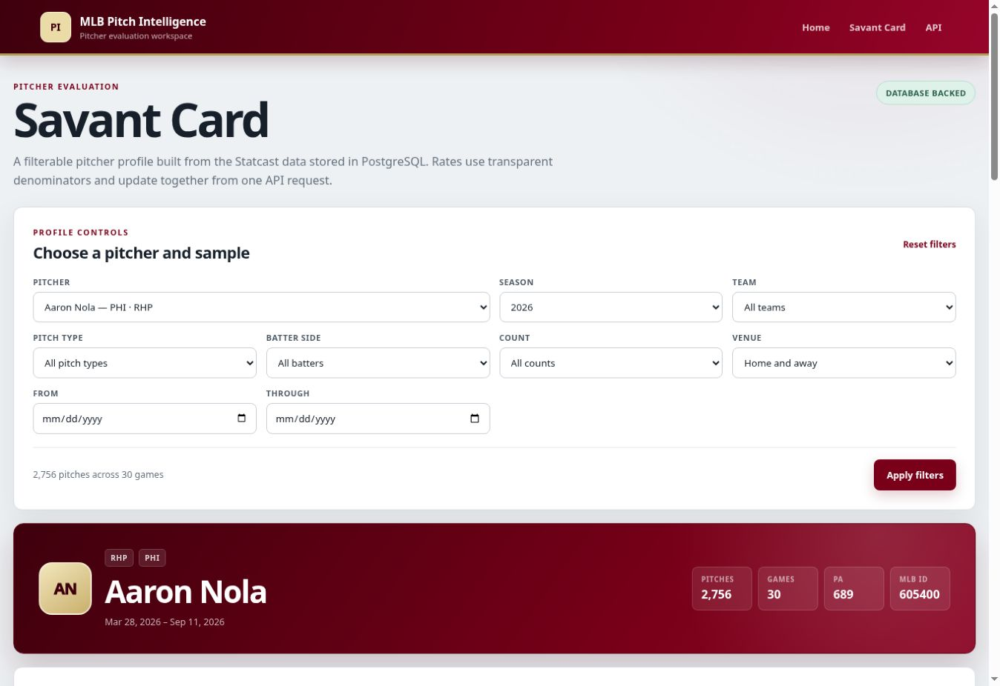
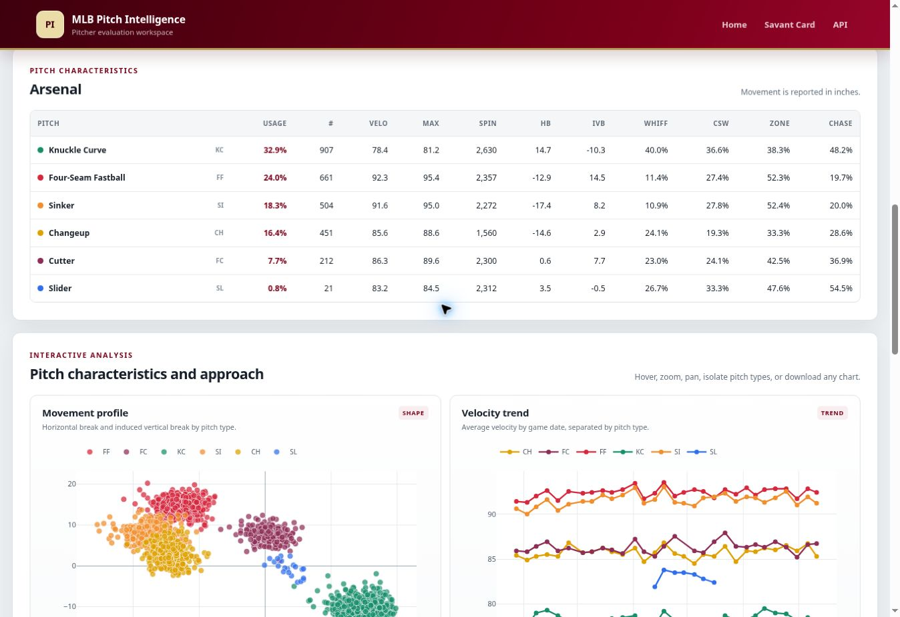

# MLB Pitcher Dashboard

[](https://github.com/bdrisc/mlb-pitcher-dashboard-flask/actions/workflows/ci.yml)

**Stack:** Python · Flask · PostgreSQL · SQLAlchemy · Alembic · Plotly · Docker · Render

**[Open the live Pitcher Report](https://mlb-pitch-intelligence.onrender.com/savant-card)** ·
**[Browse the pitcher API](https://mlb-pitch-intelligence.onrender.com/api/v1/pitchers)**

MLB Pitcher Dashboard is a production Flask and PostgreSQL statistical evaluation platform for
comparing pitcher outcomes, plate discipline, contact quality, arsenals, shape, command, and
trends from MLB Statcast data. It combines
a reproducible data-ingestion pipeline, versioned JSON APIs, shared filter validation, a
responsive Savant-style interface, and five interactive Plotly visualizations.

**Portfolio role:** this project demonstrates statistics-first product design, relational data
modeling, SQL aggregation, automated data refresh, and production Flask architecture. Its
companion Video Scouting Workspace focuses on film review, clip organization, and scouting notes
rather than repeating this application's full statistical report.



## Portfolio highlights

- **Production Flask architecture:** application factory, browser and API blueprints, Jinja
  templates, service modules, environment-backed configuration, and structured error handling.
- **PostgreSQL data layer:** SQLAlchemy models, Alembic migrations, SQL-level aggregations,
  transactional upserts, stable pitch identifiers, and auditable ingestion runs.
- **Statcast pipeline:** resumable season acquisition, cached five-day downloads, bounded-memory
  CSV streaming, schema validation, deterministic production sampling, and idempotent reloads.
- **Interactive pitcher evaluation:** filters for pitcher, season, team, pitch type, batter side,
  count, venue, and date range; arsenal tables; platoon splits; and denominator-aware metrics.
- **Software delivery:** 58 automated tests, Ruff checks, GitHub Actions CI, Docker Compose,
  Gunicorn, a non-root production image, and public deployment on Render.



## Data scope

The public application contains **133,933 pitches from the 50 busiest MLB pitchers** through
September 14, 2026. Every pitch thrown by each selected pitcher is retained, so arsenal usage,
game trends, platoon splits, and rate denominators remain internally valid.

The local acquisition pipeline supports the full-league dataset. The current local build contains
**663,035 MLB pitches** through September 14, 2026; that larger cache remains outside Git while the
reproducible acquisition command and compressed portfolio sample are included in the repository.

> The public app runs on Render's free infrastructure and may need a short cold start before the
> first request completes.

## Project structure

```text
mlb-pitch-intelligence-flask/
├── app/
│   ├── blueprints/
│   │   ├── api.py
│   │   └── main.py
│   ├── commands/statcast.py
│   ├── services/
│   │   ├── database_queries.py
│   │   ├── filters.py
│   │   ├── pitch_data.py
│   │   ├── pitcher_charts.py
│   │   ├── pitcher_profiles.py
│   │   ├── plots.py
│   │   ├── statcast_acquisition.py
│   │   └── statcast_ingestion.py
│   ├── static/
│   │   ├── savant-card-charts.js
│   │   ├── savant-card.js
│   │   └── styles.css
│   ├── templates/
│   │   ├── base.html
│   │   ├── index.html
│   │   └── savant_card.html
│   ├── __init__.py
│   ├── config.py
│   ├── extensions.py
│   └── models.py
├── data/
│   ├── sample_statcast.csv
│   └── production_statcast_2026.csv.gz
├── .github/workflows/ci.yml
├── migrations/
├── scripts/docker-entrypoint.sh
├── tests/
├── .dockerignore
├── .env.example
├── Dockerfile
├── docker-compose.yml
├── gunicorn.conf.py
├── render.yaml
├── requirements.txt
├── requirements-data.txt
├── requirements-dev.txt
└── wsgi.py
```

## Windows setup

From PowerShell in the project folder:

```powershell
py -3.10 -m venv .venv
Set-ExecutionPolicy -Scope Process -ExecutionPolicy RemoteSigned
.\.venv\Scripts\Activate.ps1
python -m pip install --upgrade pip
python -m pip install -r requirements-dev.txt
Copy-Item .env.example .env
```

Create a PostgreSQL database named `mlb_pitch_intelligence`. You can use pgAdmin or:

```powershell
createdb -U postgres mlb_pitch_intelligence
```

Open `.env` and replace `replace-with-your-password` in `DATABASE_URL` with your PostgreSQL
password. Then build the four database tables from the included migration:

```powershell
flask --app wsgi db upgrade
```

Start the browser application:

```powershell
flask --app wsgi run --debug --port 8080
```

Open `http://127.0.0.1:8080`. After ingesting data, the Savant Card is available at
`http://127.0.0.1:8080/savant-card`.

The included CSV is an explicitly fictional Statcast-shaped sample that makes the project
runnable before a real MLB export is added. Set `PITCH_DATA_PATH` in `.env` to use another CSV.

## Ingest an MLB Statcast export

Place an authorized Baseball Savant CSV in `data/raw/`. That directory is excluded from Git.
From the repository root, run:

```powershell
flask --app wsgi statcast ingest data\raw\statcast.csv
```

The command:

- validates the required Statcast columns and numeric fields;
- generates `game_pk_at_bat_number_pitch_number` as the stable pitch ID;
- standardizes pitch names;
- derives strike, swing, contact, whiff, CSW, zone, chase, and hard-hit flags;
- converts Statcast movement from feet to inches;
- upserts players, games, and pitches without duplicating existing pitch IDs;
- rolls back every baseball-data write if any part of the load fails; and
- writes a succeeded or failed record to `ingestion_runs` with the source hash and row counts.

Rerunning a corrected or expanded export is safe. Existing pitches are updated and new pitches
are inserted.

The bundled fictional sample now uses the complete ingestion schema. It can safely populate a
new development database before you obtain a real Baseball Savant export:

```powershell
flask --app wsgi statcast ingest data\sample_statcast.csv
```

The sample creates fictional pitcher MLB ID `999001` for local API testing.

## Download the complete 2026 season locally

The local Flask app uses the PostgreSQL connection in your local `.env`; it does not use the
Render database. Install the optional data-acquisition dependency in the activated virtual
environment:

```powershell
python -m pip install -r requirements-data.txt
```

Download every completed 2026 regular-season date through September 14 and ingest each cached
chunk into local PostgreSQL:

```powershell
flask --app wsgi statcast fetch-season 2026 --through 2026-09-14
```

The command requests five calendar days at a time, excludes spring-training and incomplete
records, caches usable rows under `data/cache/statcast/2026/`, and commits each chunk through the
existing idempotent ingestion service. The cache directory is excluded from Git. If a request
fails, rerun the same command: completed chunks are reused and the database upserts prevent
duplicates.

After the real-season load completes successfully, remove only the bundled fictional records:

```powershell
flask --app wsgi statcast remove-fictional-sample
```

This command targets the sample's reserved game and player IDs. It does not delete real MLB
pitches or clear the ingestion audit history.

To extend the local database after additional games are played, use a later completed date or
omit `--through` to use yesterday:

```powershell
flask --app wsgi statcast fetch-season 2026
```

To update only the deployed pitcher cohort, redownload a small overlapping window and upsert it:

```powershell
flask --app wsgi statcast sync-recent --lookback-days 4
```

The overlap captures delayed Statcast corrections without creating duplicates. If the database is
more than four days behind, the command starts from its latest stored game date and catches up in
seven-day chunks. It keeps the public cohort stable by discarding pitches from pitchers who are
not already represented in PostgreSQL.

Useful alternatives:

```powershell
# Download and cache without changing PostgreSQL
flask --app wsgi statcast fetch-season 2026 --download-only

# Replace existing cache files with fresh Baseball Savant responses
flask --app wsgi statcast fetch-season 2026 --force-download
```

## Build the public top-50-pitcher dataset

After the local season acquisition finishes, create a compressed production export containing
the 50 pitchers with the most pitches and every cached pitch thrown by those pitchers:

```powershell
flask --app wsgi statcast build-production-sample 2026 --pitchers 50
```

This produces:

- `data/production_statcast_2026.csv.gz`, the deployable ingestion source; and
- `data/production_statcast_2026.manifest.json`, the selection rule, row count, MLB IDs, names,
  and pitch totals needed to document the public sample.

The production export is intentionally selected by complete pitcher history rather than random
pitch rows. That keeps arsenal usage, trends, splits, and rate denominators internally valid.
The checked-in production file contains 133,933 pitches from the 50 busiest pitchers through
September 14, 2026. The full league cache remains local and is never committed.

## API routes

```text
GET /api/v1/ready
GET /api/v1/pitchers
GET /api/v1/pitchers/<pitcher_id>/profile
GET /api/v1/pitchers/<pitcher_id>/charts
GET /api/v1/pitches
GET /api/v1/plots/movement?pitcher=Sample%20Pitcher
```

## Savant Card

`GET /savant-card` serves a reusable Jinja page layout, while a separate JavaScript module
loads pitcher data from the versioned JSON API. The page includes:

- a database-backed pitcher selector;
- season, team, pitch type, batter side, count, venue, and date-range filters;
- URL-synchronized filter state for reproducible profiles;
- loading, empty-database, empty-sample, and structured API-error states;
- 10 headline metrics with denominator-aware formatting;
- a pitch-level arsenal table and right/left platoon cards;
- five interactive Plotly charts with hover details, legend isolation, zoom, pan, and PNG export;
- responsive layouts for desktop, tablet, and mobile screens.

The page does not calculate baseball metrics in the browser. It sends the active filter set to
the pitcher profile API and renders the returned SQL aggregates, keeping the API as the single
source of truth. It sends the same normalized filters to the chart-data API, so every metric,
table, and chart represents the same sample.

The five visualizations are:

1. movement profile by pitch type;
2. average velocity by game date;
3. release-point consistency;
4. pitch location with the sample's average strike zone;
5. pitch usage within each count.

Dense scatter plots are sampled deterministically at 6,000 points for browser performance, while
the velocity and count-usage calculations continue to use the complete filtered sample. Plotly.js
is loaded from its official CDN with an explicit version rather than the frozen
legacy `plotly-latest` bundle.

`GET /api/v1/pitchers` is a database-backed directory that returns stable MLB IDs, names,
throwing hands, teams, pitch counts, game counts, and date coverage. It accepts the shared
filters, including a partial `pitcher` name search.

`GET /api/v1/pitchers/<pitcher_id>/profile` returns:

- pitcher identity and teams represented in the filtered sample;
- sample sizes and first/last game dates;
- overall velocity, shape, plate-discipline, contact-quality, strikeout, and walk metrics;
- pitch-level arsenal usage and performance metrics; and
- right- and left-handed batter splits.

`GET /api/v1/pitchers/<pitcher_id>/charts` returns five chart-ready datasets. It selects only the
database columns needed for the visualizations, applies the shared filter contract before data
leaves PostgreSQL, and retains `null` rates when a pitch type has no valid opportunity denominator.

All aggregations execute in SQL. The API reports rates as percentages, returns `null` when a
rate has no valid denominator. Avg Exit Velocity, Hard-Hit%, and `xwoba_on_contact` use only
tracked balls in play; foul-ball exit readings and pitch-level plate-appearance estimates are
excluded.

After ingesting the fictional sample, open:

```text
http://127.0.0.1:8080/api/v1/pitchers/999001/profile?season=2026
http://127.0.0.1:8080/api/v1/pitchers/999001/charts?season=2026
```

The pitch summary and movement chart use the same validated filters:

| Query parameter | Accepted values |
| --- | --- |
| `pitcher` | Case-insensitive partial name; required for the movement chart |
| `team` | Two- or three-letter MLB team code |
| `pitch_type` | Statcast code or full name; repeat it or use commas for multiple types |
| `batter_side` | `R`, `L`, `right`, or `left`; supports multiple values |
| `season` | Integer from 2008 through the current year |
| `date_from`, `date_to` | Inclusive ISO dates in `YYYY-MM-DD` format |
| `balls` | Integer from 0 through 3 |
| `strikes` | Integer from 0 through 2 |
| `home_away` | `home`, `away`, `H`, or `A` |

Example:

```text
/api/v1/pitches?pitcher=Sample%20Pitcher&pitch_type=FF,SL&batter_side=R&season=2026
```

Scalar filters may appear only once. Unknown parameters, unsupported categorical values,
out-of-range counts, malformed dates, and reversed date ranges return HTTP `400` with details
for every invalid field:

```json
{
  "error": "validation_error",
  "message": "Invalid query parameters.",
  "details": {
    "balls": ["must be between 0 and 3"]
  }
}
```

## Tests and code quality

```powershell
python -m pytest
python -m ruff check .
python -m ruff format --check .
```

The suite covers route behavior, filter validation, Statcast ingestion, pitcher-profile and
chart aggregations, production configuration, security headers, and the deployment manifests.
The GitHub Actions workflow runs these checks against PostgreSQL 17 on Python 3.10 and 3.12,
smoke-tests the migrated API, and builds the Docker image before a pull request can be merged.

## Run the complete stack with Docker

Install and start Docker Desktop, then run this from the repository root:

```powershell
docker compose up --build
```

Compose starts PostgreSQL 17, waits for it to become healthy, applies the database migrations,
loads the fictional sample data idempotently, and serves the Flask app through Gunicorn at
`http://127.0.0.1:8080`. The API health check is available at
`http://127.0.0.1:8080/api/v1/ready`.

Press `Ctrl+C` to stop the foreground process, then remove the stopped containers:

```powershell
docker compose down
```

The named PostgreSQL volume preserves the database between runs. Only use
`docker compose down -v` when you intentionally want to erase that local Docker database.

## Deploy on Render

`render.yaml` defines a free Docker web service with an externally supplied PostgreSQL
connection. The public deployment uses Neon PostgreSQL; local Docker Compose still runs its own
PostgreSQL 17 database.

The current public deployment uses the existing Neon **Launch** organization, with a 0.25–0.5 CU
compute and a five-minute idle timeout. Render web hosting remains on its Free plan.

1. Create a Neon project near the existing Render service's region (Oregon for this deployment).
   For a new account, the Free plan is an alternative if its quotas fit your dataset.
   Select PostgreSQL 17 to match the local and CI environments.
2. Copy the **direct** PostgreSQL connection URL from Neon's Connect dialog. Keep the supplied
   SSL parameters. This one-worker app can use a direct connection for both migrations and queries.
3. In the existing Render web service's **Environment** settings, replace `DATABASE_URL` with
   that URL. Store it only as a secret environment variable, never in GitHub source code.
   `sync: false` in the Blueprint leaves the secret under dashboard control. For an existing
   Blueprint, set this value manually; syncing the YAML alone will not replace the old URL.
4. Deploy the updated code to the existing Render web service to keep its public URL. Set its
   **Health Check Path** to `/api/v1/live` if the service is not managed by a Blueprint.
5. Keep `RUN_MIGRATIONS=1`, `SEED_DATABASE=1`,
   `STATCAST_SEED_PATH=data/production_statcast_2026.csv.gz`, and `SYNC_RECENT_ON_STARTUP=1`.
   Startup maintenance applies migrations, imports the bundled production dataset into an empty
   database, then refreshes the existing pitcher cohort. It runs in the background, so the page
   can open before the data is ready. Wait for the successful maintenance messages in deploy logs.
6. Check `/api/v1/ready` manually for database readiness, then open `/api/v1/pitchers` and a
   Savant Card to verify the data and charts. The `/api/v1/live` hosting probe and legacy `/api/v1/health` alias check only the
   web process so routine health checks do not keep Neon's database awake.
7. In Neon's SQL Editor, check storage after the initial load and periodically as data grows:

   ```sql
   SELECT pg_size_pretty(pg_database_size(current_database())) AS database_size;
   ```

Neon's current Free plan includes 1 GB of database storage and 100 CU-hours per project per
month. Check the console's usage meters and [current pricing](https://neon.com/pricing) before
expanding the public dataset. The database scales to zero when idle; the first query may take
longer. Avoid uptime monitors that repeatedly call database-backed routes. Render's free web
service also sleeps when idle and retains its existing monthly usage limits.

The old Render database is no longer declared in this Blueprint. Do not delete it until the new
database has been verified and any data absent from the bundled seed has been recovered or
redownloaded. An expired Render database requires an upgrade to regain access; rebuilding from
the checked-in seed and public Statcast source avoids depending on that export. Ingestion audit
history from the old database is not recreated. The existing daily Render deploy-hook workflow
continues to refresh the Neon-backed deployment without a new GitHub secret.

Render generates the production secret. `PITCH_DATA_PATH` keeps the small fallback source used
by legacy in-memory routes separate from `STATCAST_SEED_PATH`, the database-ingestion source.
Later restarts detect existing MLB data and skip the seed import.

Deployments created before `STATCAST_SEED_PATH` was introduced remain compatible: when the
production `PITCH_DATA_PATH` still points to the compressed seed file, Flask automatically uses
the bundled six-row CSV only for the lightweight in-memory fallback while the full compressed
file is streamed into PostgreSQL.

For other Linux container platforms, the production process is:

```text
gunicorn --config gunicorn.conf.py wsgi:app
```

Set `APP_ENV=production`, a strong `SECRET_KEY`, `DATABASE_URL`, and `BEHIND_PROXY=1`. The app
refuses to start in production when the development-only secret is still configured.

### Free daily data refresh

The checked-in `Daily Statcast Sync` GitHub Actions workflow triggers a normal Render deployment
at 15:00 UTC during the regular-season window (March 15 through October). During startup, the web
service downloads the previous four days through yesterday, retains only the deployed pitcher
cohort, and transactionally upserts those pitches. The old deployment remains available if a
refresh fails, and offseason deployments do not consume the free build allowance.

Complete these one-time setup steps after deploying the branch:

1. Open the Render web service's **Settings** page and create or copy its deploy hook URL.
2. In GitHub, open **Settings → Secrets and variables → Actions**, create a repository secret
   named `RENDER_DEPLOY_HOOK_URL`, and paste the deploy hook URL as its value.
3. Open **Actions → Daily Statcast Sync** and run the workflow manually once.
4. Confirm the Render deploy logs contain `Recent Statcast sync completed` and the Savant Card's
   database coverage date advances.

The deploy hook is a credential and must never be committed. GitHub can disable scheduled
workflows on inactive public repositories after an extended period, so confirm the workflow is
enabled before each new season.

## Architectural decisions

- `create_app()` prevents configuration and data state from being locked to one module import.
- Blueprints separate server-rendered pages from the versioned JSON API.
- `PitchDataStore` owns source detection, normalization, filtering, and summaries.
- Flask-SQLAlchemy owns the relational model layer and Flask-Migrate owns schema revisions.
- The `statcast` Flask CLI group keeps repeatable data work outside request handlers.
- `PitchFilters` gives browser, chart, and future database endpoints one canonical query contract.
- Filter responses expose normalized MLB codes so URLs are reproducible across clients.
- Pitcher profiles aggregate inside PostgreSQL instead of loading an entire season into Python.
- The pitcher directory exposes stable MLB IDs for the Savant Card player selector.
- Chart queries reuse the exact profile filters and select only visualization fields from the
  database.
- Plotly rendering lives in its own browser module instead of mixing chart code into Flask views.
- Rate denominators are explicit, and zero-opportunity rates serialize as `null` rather than zero.
- Plot generation is isolated from request handling and uses a non-interactive backend.
- Missing or invalid data produce readable `503` responses while the app remains diagnosable.
- The health endpoint verifies both the SQL connection and pitch-data source for orchestrator
  manual readiness checks; hosting probes use the database-free liveness endpoint.
- Gunicorn serves production traffic, while `ProxyFix` is enabled explicitly behind a trusted
  platform proxy.
- The container runs as an unprivileged user and starts only after optional migration and sample
  ingestion hooks finish successfully.
- CI proves migrations, ingestion, API responses, linting, formatting, and image construction on
  every proposed change.
- MLB Statcast movement is converted from feet to inches during normalization.
- The original TrackMan schema remains temporarily supported so the restructure does not discard
  the prototype's earlier functionality.

## FanGraphs pitch models

Pitcher reports include FanGraphs' published Stuff+, Location+ and Pitching+
as the final three main metrics and adjacent arsenal columns, in that order. These are **regular-season reference grades**, not calculations from the
filtered Statcast pitches. Select one season. Date, team, count and handedness
filters do not change the season reference. Missing grades display as a dash.
Source metadata and import time remain in the profile API.

FanGraphs fastball (`FA` / API `sp_s_FF`) maps to Statcast four-seam (`FF`).
Sinker, cutter, curveball, knuckle curve, changeup, splitter and forkball map by
category. Sweeper/slurve grades are not inferred from slider grades. When a
pitcher has a Statcast sweeper/slurve during the season and FanGraphs does not
provide separate sweeper grades, the slider row is also withheld, even when the
current filters hide those other pitches. Overall Stuff+ remains available.

The bundled `data/fangraphs_stuff_2026.csv` snapshot was retrieved from the
[FanGraphs leaderboard](https://www.fangraphs.com/leaders/major-league?stats=pit&qual=0&type=36&season=2026&season1=2026)
on October 17, 2026 UTC (October 16 Eastern): 868 pitchers, minimum innings zero.
It stores only IDs, season and published Stuff+, Location+ and Pitching+ grades. It is not a fitted model.
Source methodology: [FanGraphs primer](https://library.fangraphs.com/pitching/stuff-location-and-pitching-primer/).

### Local update

After pulling the repository, rebuild the local Docker app:

```bash
git pull origin main
docker compose up -d --build
```

Startup applies migrations, seeds the snapshot if a season lacks the complete model metrics,
and attempts a live refresh. The same startup steps run on Render. The existing
daily deploy workflow therefore refreshes both Statcast and FanGraphs. Refresh
failure leaves the previous snapshot intact and never prevents the web server
from starting. Set `SYNC_FANGRAPHS_ON_STARTUP=0` to disable seed/refresh maintenance.
No new paid service or credentials are required for this acquisition route.

For a Python environment:

```bash
flask --app wsgi db upgrade
flask --app wsgi fangraphs seed-if-needed
flask --app wsgi fangraphs sync --season 2026
```

Manual refresh in Docker:

```bash
docker compose exec web flask --app wsgi fangraphs sync --season 2026
```

Acquisition uses a single server-side FanGraphs leaderboard request, with a
30-second network timeout and a 120-second subprocess limit. It verifies the
response season, schema and complete row count before importing. This is an
undocumented upstream endpoint and may change; the saved snapshot remains usable.

### CSV fallback

Export a single-season FanGraphs pitching leaderboard with minimum innings zero,
overall Stuff+, Location+, Pitching+ and the `Stf+`, `Loc+`, `Pit+` pitch columns. Use combined pitcher totals rather
than separate team rows. Supply `mlb_id`/`MLBAMID`, or a CSV crosswalk containing
`key_fangraphs` and `key_mlbam`. Names are never used for matching.

```bash
flask --app wsgi fangraphs import-csv fangraphs.csv --season 2026 --crosswalk register.csv
```

Imports validate before changing saved grades, replace each matched pitcher's
season snapshot transactionally, and report unmapped pitchers. Missing pitch
grades in a successful replacement are cleared instead of retaining stale values.

## Run Value per 100 Pitches

RV/100 appears immediately before Stuff+ in the main metrics and arsenal table.
It uses Baseball Savant's context-neutral CSV run value, reverses the batter-facing
sign to pitcher value, and divides by all physical pitches, including pitches with missing run values. Positive
values mean runs prevented. Zero is valid; entirely missing data display a dash.
Overall RV/100 is weighted by physical pitch counts. Dates, handedness, count,
team, home/away and pitch filters apply to the calculation. Hover shows coverage.

The calculation was validated against Savant's neutral aggregate and all six
pitch types for Aaron Nola; see [validation](docs/rv100-validation.md).
Source pitch classifications are retained. A historical database snapshot may
differ from a subsequently revised Savant export or a full-season leaderboard.

For the full local PostgreSQL app, stop Flask with Ctrl+C, then run:

```powershell
git pull origin main
.\.venv\Scripts\Activate.ps1
python -m flask --app wsgi statcast refresh-run-values --season 2026
python -m flask --app wsgi run --debug --port 8080
```

The refresh updates only run values on pitches already in the local database.
It verifies each pitcher-season CSV against Savant's explicit context-neutral
aggregate before writing, and preserves the previous values on failure. It does
not import the public cohort or add or remove any pitches. The first full local
refresh downloads data for each existing pitcher and can take several minutes.
Use `--pitcher MLB_ID` to refresh one pitcher, or omit `--season` to refresh all
stored seasons. The public Docker app performs this refresh in background
maintenance on startup; `SYNC_RUN_VALUE_ON_STARTUP=0` disables it.

Open `http://127.0.0.1:8080/savant-card`. No new migration is needed. The local
commands use the existing `.env` connection to the full PostgreSQL database.


### Overall xwOBA Against

The main pitcher card shows `xwOBA` to three decimals. It averages
Statcast's `estimated_woba_using_speedangle` on completed plate appearances,
including the supplied strikeout, unintentional-walk and hit-by-pitch weights.
Intentional walks, sacrifice bunts, catcher interference and truncated plate
appearances are excluded. Missing expected values stay missing; they are not
replaced with actual hit results or zero. This differs from xwOBAcon, which
measures contact only. All dashboard filters apply before aggregation.

This uses fields already stored in both databases. No migration, refresh or
re-import is required: pull `main` and restart the native Flask app locally.

### VAA and HAA by pitch type

The arsenal table includes raw VAA and HAA in degrees beside HB/IVB. They
average each tracked pitch's calculated angle at the front of home plate,
with all dashboard filters applied. VAA is negative for descending pitches;
positive HAA points toward the catcher's right. Hover a cell for tracking
coverage. Missing fits display as `—`. These are raw angles, without location
or handedness normalization. See [the calculation and validation](docs/approach-angle-validation.md).

For the existing native Windows app, stop Flask, activate your usual virtual
environment and run against your existing full PostgreSQL database:

```powershell
git pull origin main
.\.venv\Scripts\Activate.ps1
python -m flask --app wsgi db upgrade
python -m flask --app wsgi statcast backfill-approach-angles --season 2026
python -m flask --app wsgi run --debug --port 8080
```

Backfill fetches trajectory data for your stored pitchers and updates only
existing trajectory/angle fields. It preserves the full local pitcher cohort
and all other metrics. It can take several minutes for a full season; rerun
the same command after any download failure to resume unprocessed pitches.
Use `--pitcher MLB_ID` for one pitcher. Optional `--csv-path PATH_TO_STATCAST_CSV`
uses a previously downloaded complete Statcast CSV first, then fetches only
remaining unprocessed pitches. No re-import of the public sample is required.

On the public app, migrations run before the web process and the background
backfill fills the existing cohort automatically. Future ingestion calculates
these angles from `vx0`, `vy0`, `vz0`, `ax`, `ay`, and `az`.

### HAA Above Expected (HAAAA)

HAAAA appears directly beside HAA in each pitch-type row. It is signed
`observed HAA - expected HAA`, with expected HAA modeled by pitch type and
throwing hand from release side and front-plane horizontal location. The
frozen reference is trained on 2025 MLB data and evaluated on 2026. Both
installations use the same coefficients. See [method and validation](docs/haaaa.md).

In your usual activated virtual environment, stop the native Flask app and run:

```powershell
git pull origin main
python -m flask --app wsgi db upgrade
python -m flask --app wsgi statcast backfill-approach-angles --season 2026
python -m flask --app wsgi statcast backfill-haaaa --season 2026
python -m flask --app wsgi run --debug --port 8080
```

The raw-angle command skips already processed pitches. HAAAA scoring runs
locally from the stored trajectories and frozen reference, preserving your
full pitcher database. No league training download is required locally.
Missing data or unsupported pitch-type/hand groups display as `—`; hover for
coverage. Positive/negative HAAAA retains raw HAA's coordinate direction,
not a universal better/worse ranking. The public app backfills automatically.
